<div align="center">

# Astral-Remake

**A pixel-faithful Dear ImGui recreation of the Astral menu, made by [kdt255](https://github.com/kdt255).**

> **This project is free.** If you paid for it, you got scammed: ask for your money back and report the seller.<br>

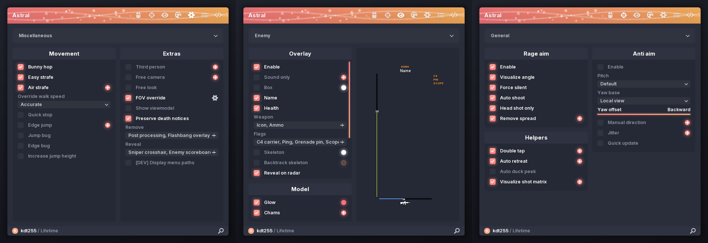

</div>

## What it is

Astral-Remake rebuilds the Astral menu UI from scratch in C++17 on top of Dear ImGui 1.92. Every widget is custom
(`ItemSize` / `ItemAdd` / `ButtonBehavior` + `ImDrawList`), measured against the original captures down to the pixel:
spacing, glows, gradients, fonts and animations.

It is a **standalone UI showcase** (Win32 + Direct3D 11 host). It does not attach to, read from or modify any game.

## Features

- **7 tabs** with SDF-rasterized vector icons: Legit, Rage, Visuals, Skins, Miscellaneous, Configs, Scripts
- **Animated title bar**: gradient, drifting and twinkling stars, sparkling ribbons
- **Custom widgets**: glowing animated checkboxes, gradient sliders with value formatters, combo and multi-combo
  dropdowns, plus / gear settings popups, color dots with a full picker (HSV, alpha, rainbow, pulse, copy, paste,
  undo), tooltips, scrollable panels with smooth scrolling and an accent scroll thumb
- **Key binds**: right-click any checkbox or slider to bind it (hold / toggle / always on), with a binds list overlay
- **Footer search** (`Ctrl + F`): dims every option that does not match
- **ESP preview**: box, skeleton, name, health, ammo, weapon and flags react live to the settings
- **Accents**: Salmon, Crimson and Sunset presets, plus a **Custom** start / end gradient
- **Crisp at any scale**: 100 - 200 % UI scale, FreeType hinting, integer font sizes, DPI-aware icon atlas
- **Configs**: create, save, load, delete, export to / import from clipboard (versioned and checksummed)
- **Scripts tab**: lists `.lua` files from `scripts\`, autoload list and a read-only source preview (no script engine)

## Screenshots

| | |
| --- | --- |
| 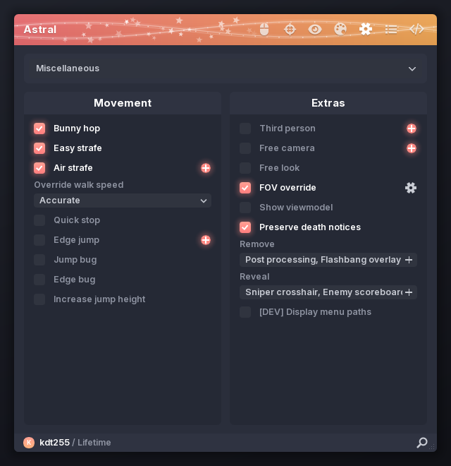 | 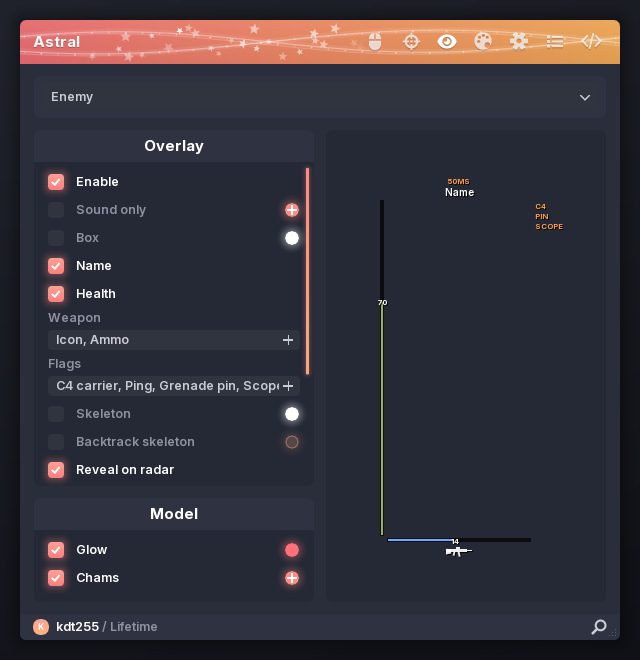 |
| 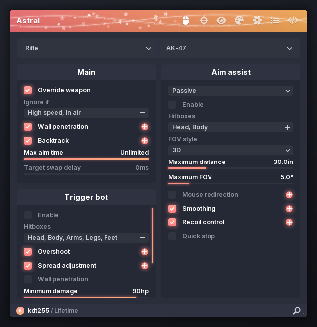 | 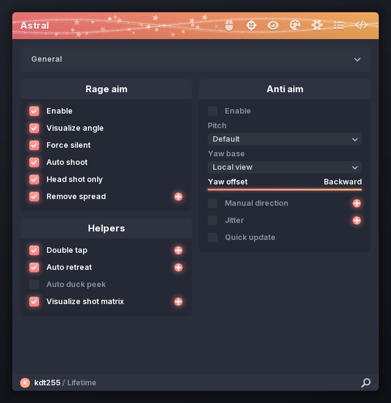 |
| 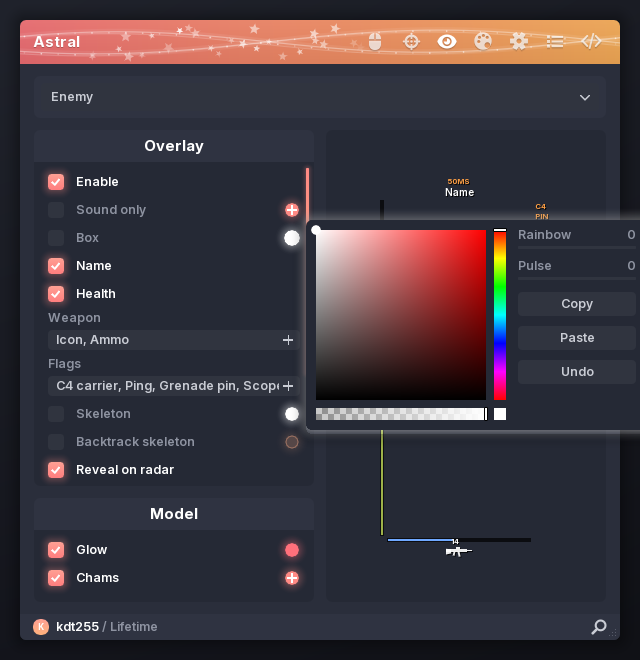 | 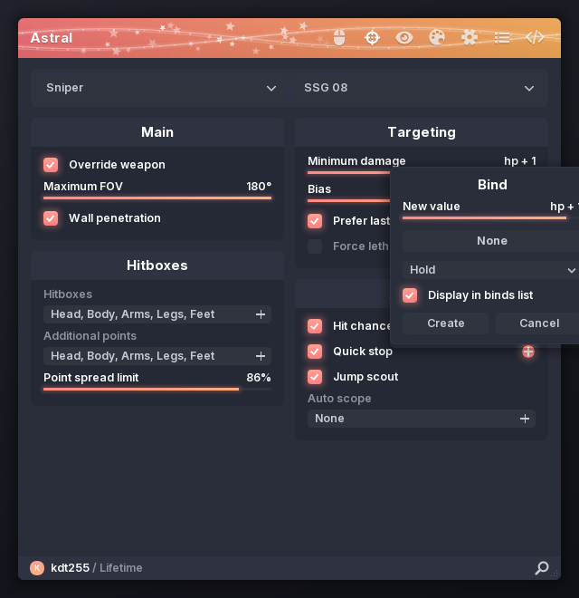 |
| 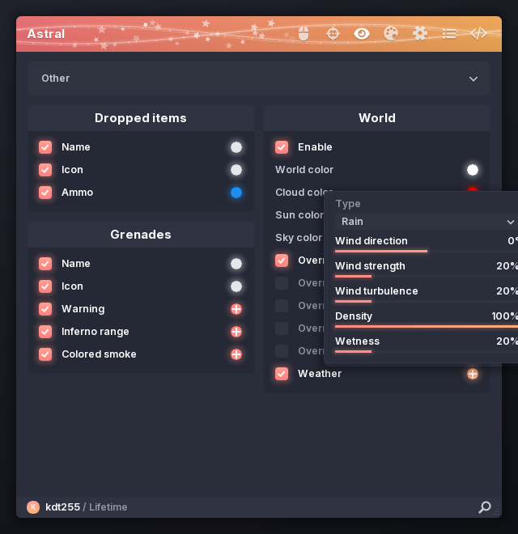 | 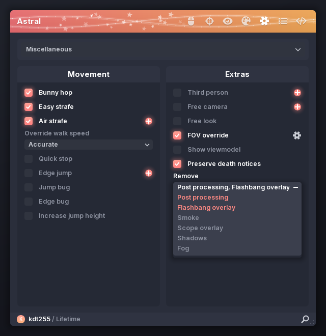 |
| 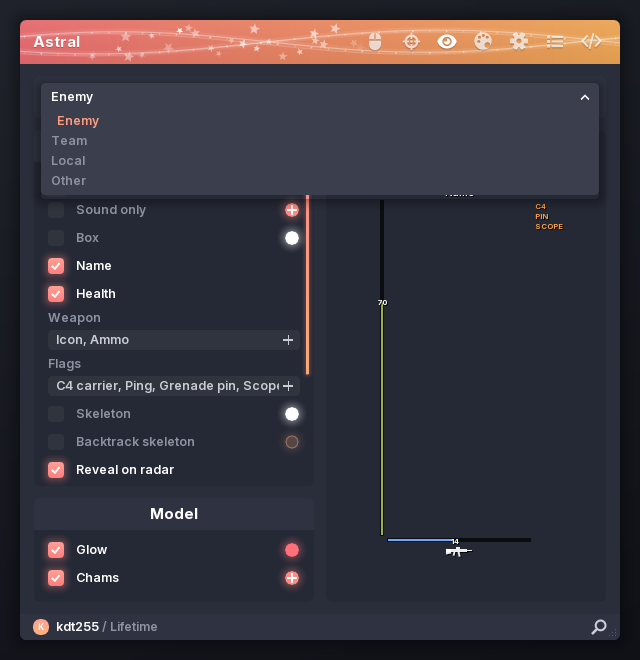 | 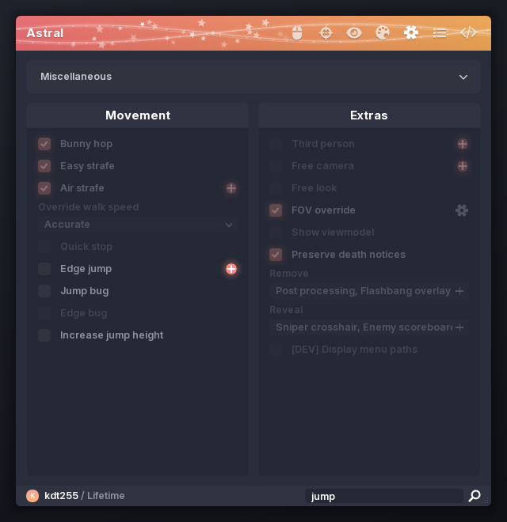 |

<details>
<summary>Accent presets (Salmon, Crimson, Sunset, Custom)</summary>

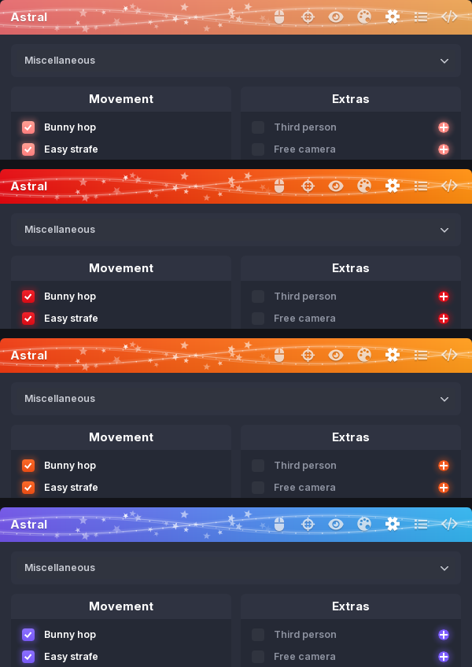

</details>

## Build

Requirements: Windows 10 / 11 x64 and Visual Studio 2022 or newer with the *Desktop development with C++* workload.

```bat
build_menu.bat
```

The script finds Visual Studio through `vswhere`, compiles everything with MSVC (`/std:c++17 /O2 /MD`) and writes
`bin\astral.exe`. Everything it needs is in the repository; no package manager is involved.

> The executable links the dynamic MSVC runtime (`/MD`, required by the bundled FreeType build), so other machines
> need the Microsoft Visual C++ Redistributable (x64).

## Controls

| Input | Action |
| --- | --- |
| `Insert` | Show / hide the menu |
| Title bar drag | Move the menu |
| Bottom-right corner drag | Resize the menu |
| Right click on an option | Bind it to a key |
| `Ctrl + F` or the magnifier | Search options |
| `Esc` | Close a popup, cancel key capture, clear the search |

## Project layout

```
menu/src/main.cpp            Win32 + D3D11 host (flip-model swap chain, DPI, occlusion, debug capture switches)
menu/src/astral/spec.h       measured metrics and accent palettes
menu/src/astral/draw.*       glows, alpha-aware gradients, stars, cap-height text placement
menu/src/astral/icons.*      SDF icon atlas uploaded through ImGui 1.92 user textures
menu/src/astral/ui.*         widget kit, panels, popups, color picker, binds
menu/src/astral/menu.*       window chrome: title bar, tabs, footer, search, overlays
menu/src/astral/pages.cpp    tab layouts
menu/src/astral/preview.*    ESP preview
menu/src/astral/persist.*    configs and scripts on disk
third_party/                 Dear ImGui 1.92.9b, FreeType 2.15.0, Inter license
```

## License

Astral-Remake is released under **MIT + Commons Clause** (see [`LICENSE`](LICENSE)): use it, learn from it, modify
it and share it for free, but **selling it is not allowed** and the kdt255 credit has to stay.

Bundled third-party components keep their own licenses, see [`THIRD_PARTY_NOTICES.md`](THIRD_PARTY_NOTICES.md).

## Disclaimer

This is an unofficial fan remake of a user interface, made for learning and showcase purposes. It is not
affiliated with or endorsed by the authors of the original Astral, and it contains no game-interaction code.
